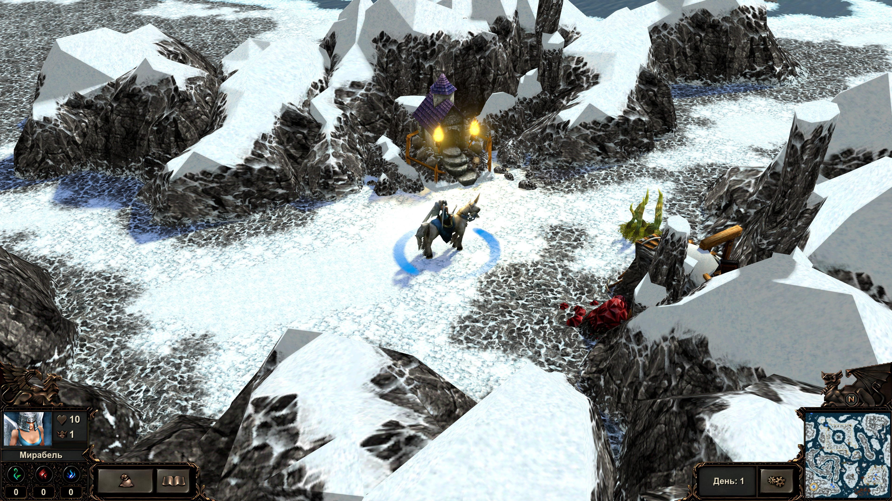
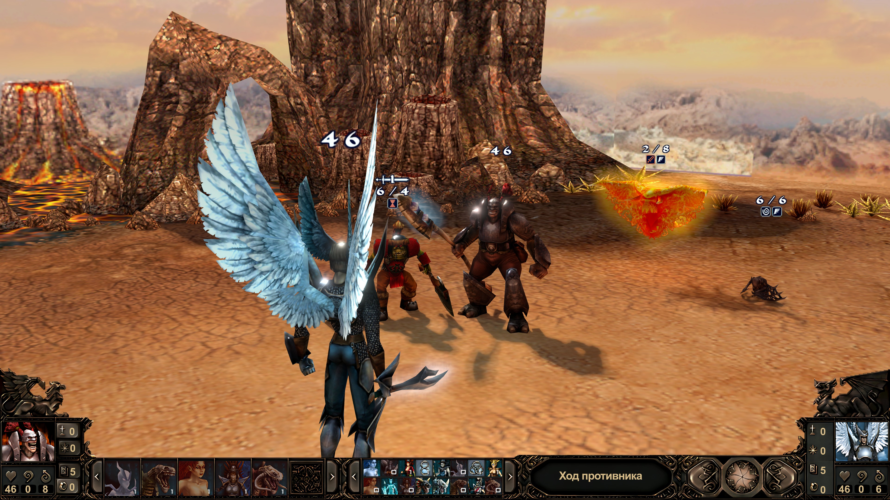
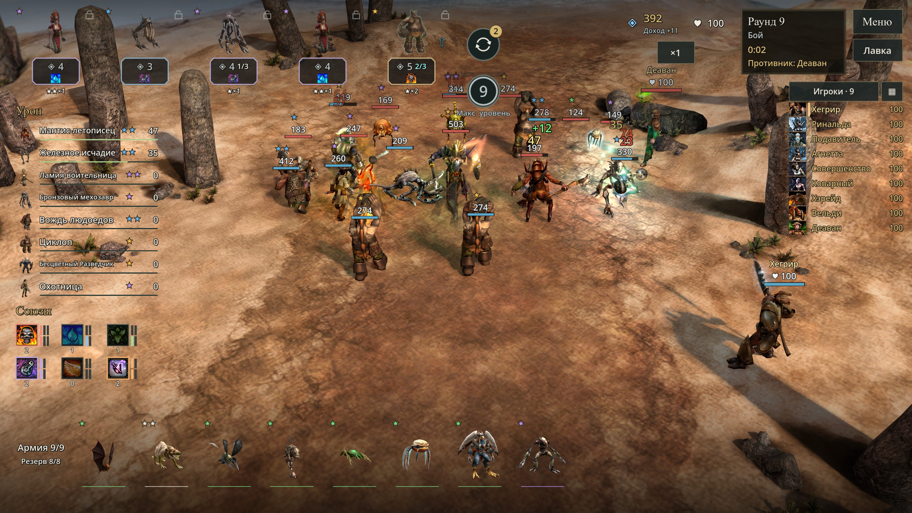

# Demiurges


Play **Etherlords** («Демиурги», Nival, 2001) and **Etherlords II** («Демиурги II», 2003) on Windows, Linux, macOS, Android, or in your browser.

**[Play in your browser](https://demiurges.wwworm.com/) · [Download](https://github.com/TheWWWorm/Demiurges/releases/latest) · [Wiki](https://demiurges.wwworm.com/wiki/) · [Вики](https://demiurges.wwworm.com/wiki/?lang=ru)**

Demiurges is a fan-made Godot engine for the two games. It loads their campaigns, maps, creatures, spells, art, music, and dialogue from your own game files. The GOG editions are tested. Install either game or both and switch between them from the main menu.

## Screenshots

Captured in the engine at 3840×2160 with path tracing, sharper icons, interface art and 3D textures, from the Russian editions of the games.




**Autochess**



## What's new in 0.19.0

- **Random missions and naval travel in Etherlords I.** Choose **Single Mission → Random map…** for seeded worlds with eight layouts and eleven presets. Route heroes through harbors, sail to other islands, and save at sea. Fresh maps put a pickup, site, or encounter within a day's travel of each reachable land tile for the slowest starting hero. [Random maps](docs/first_random_maps.md) · [Naval travel](docs/first_naval_maps.md)
- **Draft Arena in Etherlords II.** Choose **Draft Arena** on the main menu and pick a hero from animated 3D previews. Draft a 16-card book from one faction or the mixed pool and face a freshly drafted opponent each match. Both sides play at the same chosen level in new runs. Your run saves between matches and resumes from the Arena menu. [Draft Arena rules](docs/draft_arena.md)
- **Graphics and campaign fixes.** Terrain, water, fog, lighting, and model playback received updates. Etherlords II prepares animated dialogue meshes as the camera approaches on desktop, reducing the hitch at the start of conversations. This release also fixes campaign and combat reports across both games. [Full changelog](CHANGELOG.md#0190)

## Play in your browser

**[Play at demiurges.wwworm.com](https://demiurges.wwworm.com/)** - nothing to install. Open the page, press **Play** and choose one of:

- the GOG offline installer (`setup_etherlords*.exe`). It is **not run**: the browser unpacks the game files from it once and checks each one. This takes a few minutes and needs about 1.5 GB (Etherlords) or 3 GB (Etherlords II) of browser storage;
- the folder of your installed game (the one containing `Resources` and `Campaigns`), in desktop browsers;
- a game data pack (`.elpack`), if you made one.

Repeat this for the other game to keep both. Your files are never uploaded: the game reads them on your own device and keeps its copy in your browser's storage, so the next start is quick.

A data pack is optional. It helps on a phone that has neither the installer nor the game folder: make the pack on your computer and copy it to the phone. You need Python 3 and the [`tools/prepare_game_data.py`](tools/prepare_game_data.py) script from this repository:

```sh
python3 tools/prepare_game_data.py "/path/to/Etherlords II" Etherlords2.elpack
```

The installer and the pack hold your own game files, so keep them to yourself.

The browser version needs WebGL 2 and a desktop-class browser or a recent phone with plenty of memory. Unpacking a large game in the browser needs a lot of memory for a short time; if it fails on a phone, use a data pack. Intro and ending videos are not played in the browser yet. Browsers can clear their storage, so keep your installer or pack.

## Download and install

Download the package for your system from the [Releases](https://github.com/TheWWWorm/Demiurges/releases) page.

- **Windows (x86-64):** extract the ZIP and run `Demiurges.exe`. The program is not signed, so Windows SmartScreen may warn about an unrecognised app; choose **More info → Run anyway**.
- **Linux (x86-64):** extract the archive and run `Demiurges.x86_64`. If your file manager dropped the executable permission, run `chmod +x Demiurges.x86_64` first.
- **macOS (Apple silicon and Intel, one universal app):** extract the ZIP and open `Demiurges.app`. The app is not signed or notarized, so macOS may refuse the first start: right-click (or Control-click) the app and choose **Open**, or allow it under **System Settings → Privacy & Security**. You can also run `xattr -dr com.apple.quarantine Demiurges.app` in Terminal.
- **Android 7+ (ARM64 / x86-64), preview:** install the APK; allow your browser or file manager to install apps when it asks. On first start, choose a game data pack (`.elpack`, see [Play in your browser](#play-in-your-browser)) or the GOG installer (`setup_etherlords*.exe`), which is unpacked without being run. Unpacking the installer takes longer on a phone than on a computer; a data pack is quicker still.
- **Browser (WebGL 2):** nothing to download; [play the hosted version](https://demiurges.wwworm.com/), see above.
  To host the browser version yourself, use `…-web.zip`. It needs HTTPS (or `localhost`) and the `Cross-Origin-Opener-Policy: same-origin` and `Cross-Origin-Embedder-Policy: require-corp` headers (included in its `_headers` file); see [hosting the browser version](docs/hosting.md).

## Getting started (desktop)

1. Start the engine.
2. Choose **Etherlords I** or **Etherlords II** at the top of the game files screen, then one of:
   - **Choose the … game folder…**, then the folder of your installed game, the one containing `Resources` and `Campaigns`;
   - **Choose installer or data pack…**, then the GOG offline installer (`setup_etherlords*.exe`) or a data pack (`.elpack`). The installer is **not run**: the engine unpacks the game files from it once (usually well under a minute) and keeps them in its own data folder, so the installer is not needed afterwards.
3. Your choice is remembered. The original start-up videos play, then the main menu opens.

The main menu shows **Etherlords I** and **Etherlords II** under its buttons: click one to switch games. The game you played last opens at the next start. A game you have not added yet says **not installed — add…** and opens the game files screen for it. **Options › Remake settings › Game files…** opens the same screen to add a game, switch, or remove one; removing a game keeps its saves and settings, and never deletes an installed game folder.

You can also unpack the installer yourself with the included Python tool (it needs [innoextract](https://constexpr.org/innoextract/)), which registers the result:

```sh
python3 tools/import_game.py el1 /path/to/setup_etherlords.exe --dest /path/to/Etherlords
python3 tools/import_game.py el2 /path/to/Etherlords2
```

## What you can play

- **Both campaigns** of each game, with the original maps, dialogue, scripted events, shops, buildings, heroes, experience and level-ups, resource sites and spellbook management. Chapters follow the original order and branches.
- **Single missions** and seeded random maps in Etherlords I, and the Etherlords II tutorial.
- **Random maps** in Etherlords I. Open **Single Mission → Random map…** for seeded worlds against computer players, with optional ships, harbors, and naval routes. See the [random map guide](docs/first_random_maps.md).
- **Duels**: the original Duel screen with its presets and hero editor, practice battles against the computer and local hot seat for two players. Etherlords II duels can be replayed.
- **Tactical puzzles** in both games. Search **Crucible** (English) or **Горнило** (Russian) for the new Expert collection: short combinations with an ordinary victory objective and a maximum of three own turns. [Crucible guide](docs/puzzle_crucible.md).
- **Random tactical challenges** in both games. Open **Puzzles → Random challenge** for twenty-three registered tactical families across both editions, verified winning strategies for accepted challenges, variety that compares actual solution patterns, three-stage hints and shareable codes. New challenges use hand-size damage, death accounting, ordered grave recovery, and Etherlords II aspect tolls. The optional **Master** tier adds genuine two-turn plans against hostile replies, including removal and changing creature control. **Tactical hint** can check your current position after an unexpected reply. [Random puzzle guide](docs/random_puzzles.md).
- **Combat** with the original creatures, spells, abilities, enchantments, artifacts and battlefields of both games, including automatic combat.
- **Automatic battle camera**: spells, the first blow of a fight and the winner get close-ups along the games' own camera tracks before the view returns to yours. **Camera dynamics** in Options sets how often they happen, and the numbers over creatures can be hidden during close-ups. Moving the camera yourself ends a close-up at once.
- **Original interface**: the main menu, campaign and mission screens, Options, saving and loading, the map interface and the battle screen use the games' own art and texts.
- **Language**: texts come from your copy of the game.

To import an original custom duel preset, copy its `.prs` file into the remake's `user://duel/el1` or `user://duel/el2` folder for the matching game, alongside the remake's `.json` decks. Open Duel to convert it into an editable preset. The source is kept as a `.prs.imported` backup, and any existing JSON preset with the same name takes precedence. On Windows, `user://` is normally `%APPDATA%\Godot\app_userdata\Etherlords Duel`.

In Etherlords II duels, resource level 4 has a larger budget and level 5 has unlimited resources. Level 6 also lets you mix playable spells and creatures from every faction, including neutral cards, and use as many copies as you like in the 16-card deck.

## Wiki

The [**Demiurges wiki**](https://demiurges.wwworm.com/wiki/) is free to read without game files, an account or the engine. Its encyclopedia has a page for every creature (with a picture), sorcery, enchantment, artifact, skill and specialization of both games. Its guides explain installing, controls, combat rules and phases, spells and creatures, the campaigns, duels, options and the differences from the originals, in English and [Russian](https://demiurges.wwworm.com/wiki/?lang=ru). Good starting points: [installing the game files](https://demiurges.wwworm.com/wiki/?page=installing), [controls](https://demiurges.wwworm.com/wiki/?page=controls), [how a battle works](https://demiurges.wwworm.com/wiki/?page=combat) and [turn and phases](https://demiurges.wwworm.com/wiki/?page=combat-phases). The same articles open in the game: **Wiki** on the main menu or **F6** on any screen. See [the wiki guide](docs/wiki.md) to edit or rebuild it.

Creature pages in the in-game wiki can play the installed game's attack, death, and other available animations with their own sounds.

## Ether Expedition

With Etherlords II installed, select **Expedition** on the main menu for a three-act deck-building run. Choose your route through fights, merchants, camps and nineteen encounters. A starting relic and a faction study path help shape your book; elite opponents offer stronger rewards, and guardians teach combat powers such as sacrifice for ether, graveyard revival and spell-driven draws. Encounters and descriptions draw on the repository’s Etherlords wiki in English and Russian. The Mirror, Forge and Anvil let you inspect spell exchanges before paying.

New runs use **rules version 15**. The **Artifact Constructor** offers unfinished projects: take one to assemble at a later camp, or earn 12 gold sorting salvage. Keep one completed artifact with two charges that persist across duels. An elite reward can supply a finished artifact instead of a relic. Camp assembly or a one-charge refill uses the main action; the final Haven can assemble a project for 28 gold, and merchants recharge one charge for 20, before price modifiers. The damaged Recharger trades three life per missing charge. These tools use original spells and the shared artifact-use limit; they do not refill after every battle.

Keep up to two spells in reserve. Rearranging them at camp is free and leaves time for one main action; the final Haven also allows free swaps. Prepare or set aside learned powers at either stop before committing to the next fight. Library pages can go straight into your book. Card previews show what changes, while full costs, copy counts and charges remain in the Spellbook panel.

Spend a camp action rehearsing one spell from your active book, and it can occupy one of the normal five opening-hand slots, with its usual casting cost and charges. The **Shrine of Knowledge** offers the lesson instead of a 12-gold copying job; the final Haven charges 24 gold before merchant modifiers, paid only when you confirm. Set preparation aside or enable it again for free at camp or the Haven. The lesson survives reserve swaps, works while the spell is prepared and in the active book, and clears when its last owned copy is lost. Spirit Covenant can find its first Spirits in Act I. Caravan wares can be inspected before accepting the guiding job, and the late Archive avoids charging for a path change with no remaining effect.

**Resume expedition** restores the current room and combat state, including future battle randomness. A failed save pauses play until **Retry Save** succeeds. Active duels cannot be restarted. Versions 1–14 retain their saved rules; start a new run for artifact projects and recharging. See the [Expedition guide](docs/expedition_expansion.md) and [lore sources](docs/expedition_lore_sources.md).

## Autochess

With Etherlords II installed, select **Autochess** on the main menu. Nine heroes recruit Etherlords II creatures from one shared pool, evolve three copies into stronger forms, combine faction alliances and fight real-time battles on the game's battlefields; the last hero standing wins. Creature stats come from the originals' Power and Toughness, their abilities are adapted to real time, and rewards after neutral rounds are the game's own enchantments and artifacts. Play against eight computer heroes or online with a room code or by address. See [Autochess](https://demiurges.wwworm.com/wiki/?page=autochess) in the wiki.

## Multiplayer

Duels in both games, the Etherlords I strategic preview for two human commanders and online autochess can be played through an online room code (no ports to open, also in the browser) or, in native builds, over LAN and direct IP. A duel or autochess player whose connection drops can join again and take their seat back. See the [multiplayer guide](https://demiurges.wwworm.com/wiki/?page=duel) for supported map actions and connection details.

## Current limitations

The engine is still in development. Things you may notice:

- The darkening of a few large spells is an approximation, and the exact moment some ability effects start may differ slightly from the originals.
- A few rare messages are still shown in English, mostly in the Duel editor and in error messages.
- Computer opponents follow the original's approach but are not an exact copy of its decisions. As in the original, they never answer alliance or trade offers.
- Etherlords II map particle effects use approximate sizes and blending.
- The campaigns are tested screen by screen and system by system, not yet by playing every chapter from start to finish. Please report anything that blocks progress.
- Saves and replays of the original games cannot be loaded; the engine keeps its own.
- Touch controls have not yet been tried on real phones and tablets, only in testing. The interface keeps the original layout, so on a small phone screen text and buttons are small.

Please report problems on the [Issues](https://github.com/TheWWWorm/Demiurges/issues) page. The wiki lists [known gaps](https://demiurges.wwworm.com/wiki/?page=troubleshooting) and [differences from the originals](https://demiurges.wwworm.com/wiki/?page=differences).

## Controls

The wiki has the [full controls](https://demiurges.wwworm.com/wiki/?page=controls) and [combat rules](https://demiurges.wwworm.com/wiki/?page=combat). **F6** opens the wiki in the game.

The original controls work as in the games. A few useful keys:

| Key | Battle | Map |
|---|---|---|
| Left click | choose a spell, creature or target | move, talk, visit or attack |
| Space | skip the current presentation | continue a conversation |
| Ctrl+E (EL1) / Tab (EL2) | end the current phase | — |
| Esc | cancel targeting, or open the game menu | close a window, or open the game menu |
| F5 / F9 | quick save / quick load | quick save / quick load |
| Right drag, wheel | turn and zoom the camera | turn and zoom the camera |
| R | reset the camera | |
| W A S D, arrows | | move the camera |
| H or Home | | follow the selected hero |
| I / K | | spellbook / skills (first game) |
| N | | end the turn (first game) or the day (second game) |

**Touch screens** (phones, tablets and touch browsers) have their own controls:

| Gesture | Battle | Map |
|---|---|---|
| Tap | as a left click | as a left click |
| Touch and hold | right click; on a button, its tooltip | right click (Etherlords II: the information panel while held) |
| Drag with one finger | turn the camera | move the map |
| Drag or twist with two fingers | turn and tilt the camera | turn and tilt the camera |
| Pinch | zoom | zoom |

A small bar at the top of the screen gives **Back** (Esc) everywhere, **Camera** (reset) in battle and **Save** / **Load** (quick save and load) on the map. On Android the Back button also works as Esc.

Press the **grave/tilde** key under **Esc** (**Ё** on a Russian keyboard), press **F10**, or tap **Console** on a touch device to open the developer console. In a mission or local battle, choose **Enable commands** or enter `EtherRevelation`. **Help** lists the available commands. **Tab** completes a suggestion, **Enter** runs it, and the up and down arrows recall earlier commands. Use **Find** to filter output and **Copy** to copy it. Press **Esc** or the console key to close the panel. Game commands are disabled in network duels.

## Saves and settings

Saves and settings are kept in the engine's user folder:

- **Linux:** `~/.local/share/godot/app_userdata/Etherlords Duel`
- **Windows:** `%APPDATA%\Godot\app_userdata\Etherlords Duel`
- **macOS:** `~/Library/Application Support/Godot/app_userdata/Etherlords Duel`
- **Browser:** in the browser's storage for this site. Clearing the site's data removes them.
- **Android:** in the app's private storage. Uninstalling the app removes them.

The folder keeps its earlier name, `Etherlords Duel`, so existing saves continue to work.

In Etherlords I, **AI fights neutral monsters** is off by default. Enable it on the difficulty screen to have Living world computer heroes forecast and play neutral fights. This also rebalances ordinary field guards. The easiest difficulty is recommended for this option.

In **Remake settings**, **Terrain detail** adds subtle texture contrast and surface relief to adventure-map ground, and fine grain from the original detail textures to battle ground where available. **Enhanced water** adds ripples, a subtle sky tint and foam along adventure-map shores. **Soft shadows** smooths sun-shadow edges in battles and on Etherlords II maps. All three start off and can be changed during play.

**Path-traced lighting** (Remake settings › Graphics) adds real shadows, sky light, light bounced between surfaces and light from fire and spells, on maps and in battles. It needs the **Forward+ (Vulkan)** renderer, chosen on the same tab (the game restarts with it), and a graphics card with ray tracing. **F7** switches it during play. The remake's own screens are shown in the language of your game: Russian for a Russian copy, English otherwise.

## Building from source

The engine source is in [`game`](game). Open it in [Godot 4.7](https://godotengine.org/) and press Play, or export it with the included presets.

- **Windows, Linux, macOS:** `godot-4 --headless --path game --export-release "Windows Desktop" ../build/windows/Demiurges.exe`, with `Linux` and `../build/linux/Demiurges.x86_64`, or `macOS` and `../build/macos/Demiurges.zip`. The output path is relative to `game`; create the folder first.
- **Browser:** `python3 tools/export_mobile.py web --output build/web`, then `python3 tools/serve_web.py build/web` and open `http://localhost:8060/`. The Web template's export alone is not enough: this tool also adds the page's local-file support, icons, offline cache and headers.
- **Android:** `python3 tools/export_mobile.py android --output build/android --sdk /path/to/android-sdk --java /path/to/jdk` (needs the Android SDK, a JDK 17 or newer and Godot's Android export templates).

The GOG installer is unpacked by a small compiled library in [`game/native`](game/native), prebuilt for every exported platform in `game/native/bin`. To rebuild it, run `python3 game/native/build.py --zig /path/to/zig --ndk /path/to/android-ndk` ([Zig](https://ziglang.org/) builds the Windows, Linux and macOS libraries, the Android NDK the Android ones). Without the library the engine still imports installers, only much more slowly.

The Godot export templates for 4.7 must be installed. See [the engine overview](docs/engine_overview.md) for how the code is organised.

## License

The engine's code is licensed under the Apache License 2.0 (see [LICENSE.md](LICENSE.md)); see [THIRD_PARTY_NOTICES.md](THIRD_PARTY_NOTICES.md) for third-party components, including the movie decoder under the LGPL 2.1. Etherlords, Etherlords II and all of their content belong to their respective owners and are not part of this project. This project is not affiliated with Nival or the publishers of the games.
